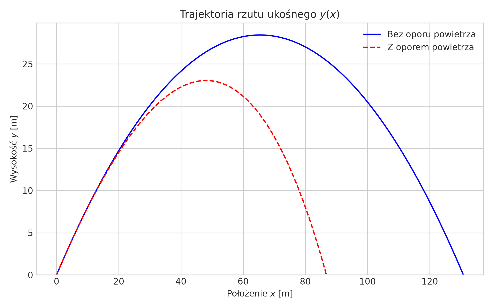
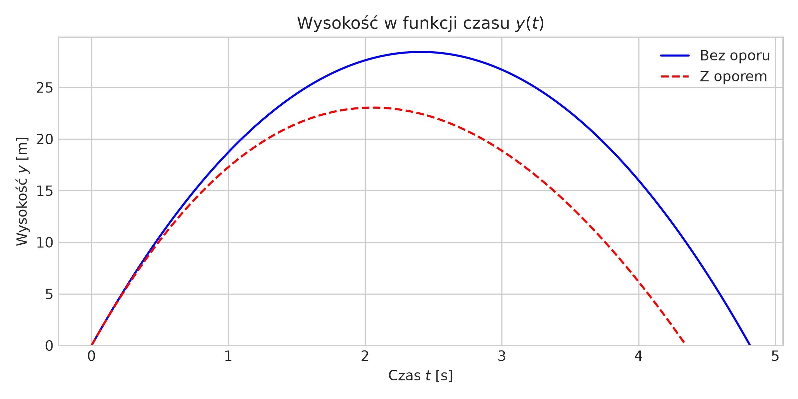
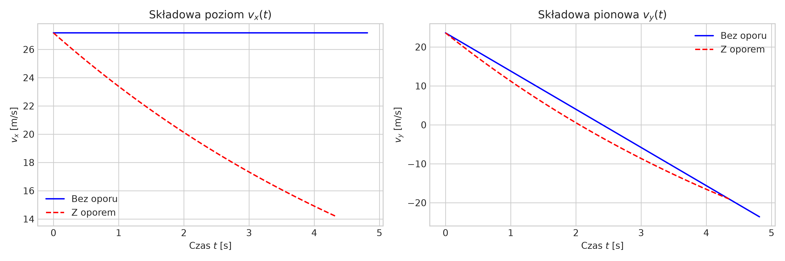

# Raport: Analiza ruchu punktu materialnego w rzucie ukośnym

**Autor:** [Magdalena Mikulak]  
**Parametry początkowe (wyznaczone na podstawie nr indeksu):**  
- Prędkość początkowa: $v_0 = 36.0\text{ m/s}$  
- Kąt wyrzutu: $\alpha = 41.0^\circ$ 
- Przyspieszenie ziemskie: $g = 9.81\text{ m/s}^2$  

---

## 1. Wstęp
Rzut ukośny jest dwuwymiarowym ruchem punktu materialnego w jednorodnym polu grawitacyjnym. Ciało zostaje wystrzelone z prędkością $v_0$ pod kątem $\alpha$ do poziomu. W raporcie przeanalizowano dwa warianty:
1. Ruch idealny w próżni (brak oporów powietrza).
2. Ruch rzeczywisty z uwzględnieniem liniowego oporu powietrza $\vec{F}_d = -b \vec{v}$.

---

## 2. Rzut ukośny bez oporu powietrza

### Równania ruchu i wyprowadzenie
Składowe prędkości początkowej wynoszą:
$$v_{0x} = v_0 \cos\alpha$$
$$v_{0y} = v_0 \sin\alpha$$

Brak sił działających w osi $X$ oznacza ruch jednostajny, natomiast w osi $Y$ działa siła ciężkości powodująca ruch jednostajnie opóźniony:
$$ax(t) = 0 \implies x(t) = v_0 \cos(\alpha) \cdot t$$
$$ay(t) = -g \implies y(t) = v_0 \sin(\alpha) \cdot t - \frac{1}{2}gt^2$$

### Kluczowe wielkości fizyczne
* **Czas lotu ($T$):** Wyznaczamy z warunku $y(T) = 0$:
  $$T = \frac{2 v_0 \sin\alpha}{g}$$
* **Maksymalna wysokość ($H_{max}$):** Dla $v_y(t_h) = 0 \implies t_h = \frac{T}{2}$:
  $$H_{max} = \frac{v_0^2 \sin^2\alpha}{2g}$$
* **Zasięg rzutu ($R$):** Wstawiając $T$ do równania na $x(t)$:
  $$R = \frac{v_0^2 \sin(2\alpha)}{g}$$

---

## 3. Rzut ukośny z oporem powietrza

W obecności oporu powietrza o proporcjonalności liniowej siła wypada jako $\vec{F} = m\vec{g} - b\vec{v}$.  
Równania różniczkowe drugiego rzędu przyjmują postać:
$$\frac{d^2x}{dt^2} + \frac{b}{m}\frac{dx}{dt} = 0$$
$$\frac{d^2y}{dt^2} + \frac{b}{m}\frac{dy}{dt} = -g$$

Ze względu na złożoność rozwiązań analitycznych, trajektorię wyznaczono numerycznie za pomocą metody Eulera:
$$v_x(t + \Delta t) = v_x(t) - \frac{b}{m}v_x(t)\Delta t$$
$$v_y(t + \Delta t) = v_y(t) - \left(g + \frac{b}{m}v_y(t)\right)\Delta t$$

---

## 4. Wyniki i Wykresy

### Trajektoria ruchu $y(x)$
Opór powietrza powoduje asymetrię trajektorii — opadanie ciała jest bardziej pionowe, a maksymalna wysokość iasięg ulegają wyraźnemu zmniejszeniu.



### Wysokość w funkcji czasu $y(t)$



### Zmiany prędkości $v_x(t)$ oraz $v_y(t)$



---

## 5. Kod Pythona użyty do generowania wykresów

```python
import numpy as np
import matplotlib.pyplot as plt

v0 = 12.0          # [m/s]
alpha_deg = 56.0   # [deg]
g = 9.81           # [m/s^2]
m = 1.0            # [kg]
b = 0.15           # [kg/s]

alpha_rad = np.radians(alpha_deg)

# Wyznaczenie trajektorii bez oporu
t_flight = (2 * v0 * np.sin(alpha_rad)) / g
t = np.linspace(0, t_flight, 200)
x = v0 * np.cos(alpha_rad) * t
y = v0 * np.sin(alpha_rad) * t - 0.5 * g * t**2

# Wyznaczenie trajektorii z oporem (metoda Eulera)
dt = 0.001
x_d, y_d = [0.0], [0.0]
vx_d, vy_d = [v0 * np.cos(alpha_rad)], [v0 * np.sin(alpha_rad)]

while y_d[-1] >= 0:
    ax = -(b / m) * vx_d[-1]
    ay = -g - (b / m) * vy_d[-1]
    vx_d.append(vx_d[-1] + ax * dt)
    vy_d.append(vy_d[-1] + ay * dt)
    x_d.append(x_d[-1] + vx_d[-2] * dt)
    y_d.append(y_d[-1] + vy_d[-2] * dt)

plt.plot(x, y, label='Bez oporu')
plt.plot(x_d, y_d, label='Z oporem')
plt.xlabel('x [m]')
plt.ylabel('y [m]')
plt.legend()
plt.savefig('trajektoria.png')