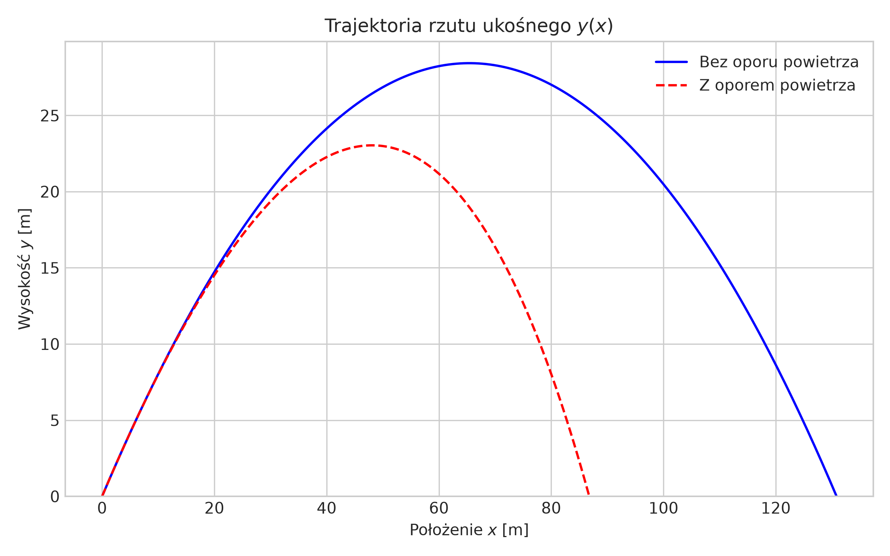
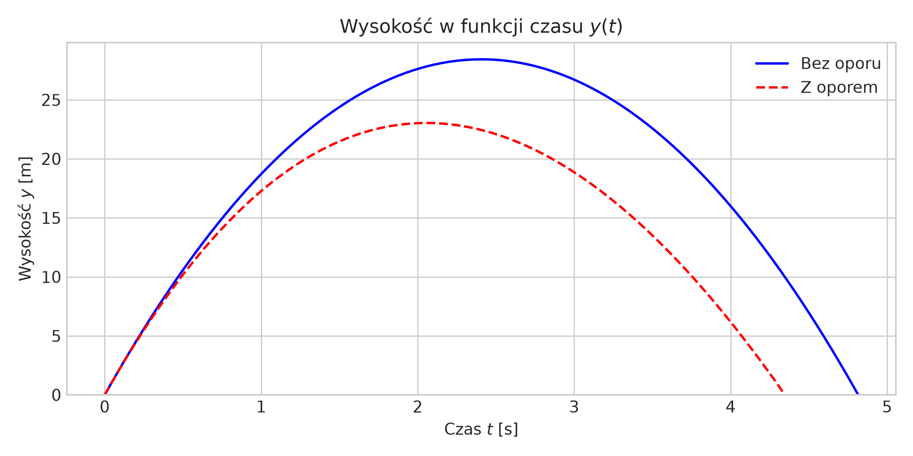
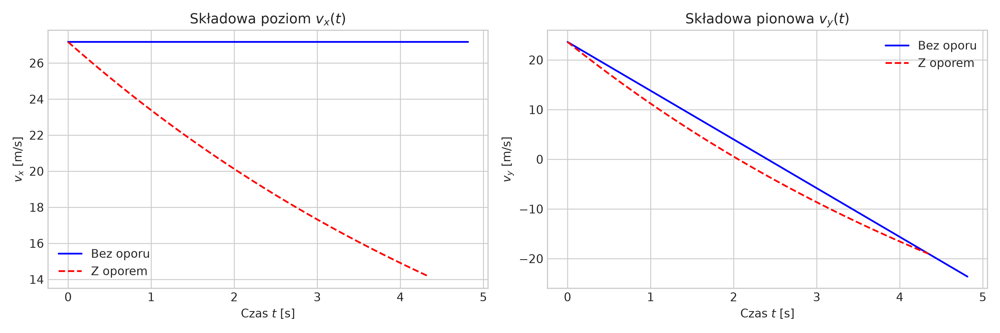

# Raport: Analiza ruchu punktu materialnego w rzucie ukośnym

**Autor:** [Magdalena Mikulak]  
**Parametry początkowe (wyznaczone na podstawie nr indeksu):**  
- Prędkość początkowa: $v_0 = 36.0\text{ m/s}$  
- Kąt wyrzutu: $\alpha = 41.0^\circ$ 
- Przyspieszenie ziemskie: $g = 9.81\text{ m/s}^2$  

---

## 1. Wstęp
Rzut ukośny jest dwuwymiarowym ruchem punktu materialnego w jednorodnym polu grawitacyjnym. Ciało zostaje wystrzelone z prędkością $v_0$ pod kątem $\alpha$ do poziomu. W raporcie przeanalizowano dwa warianty:
1. Ruch idealny w próżni (brak oporów powietrza).
2. Ruch rzeczywisty z uwzględnieniem liniowego oporu powietrza $\vec{F}_d = -b \vec{v}$.

---

## 2. Rzut ukośny bez oporu powietrza

### Równania ruchu i wyprowadzenie
Składowe prędkości początkowej wynoszą:

$$
v_{0x} = v_0 \cos\alpha
$$

$$
v_{0y} = v_0 \sin\alpha
$$


Brak sił działających w osi $X$ oznacza ruch jednostajny, natomiast w osi $Y$ działa siła ciężkości powodująca ruch jednostajnie opóźniony:

$$
ax(t) = 0 \implies x(t) = v_0 \cos(\alpha) \cdot t
$$

$$
ay(t) = -g \implies y(t) = v_0 \sin(\alpha) \cdot t - \frac{1}{2}gt^2
$$

### Kluczowe wielkości fizyczne
* **Czas lotu ($T$):** Wyznaczamy z warunku $y(T) = 0$:
  
  $$
  T = \frac{2 v_0 \sin\alpha}{g}
  $$

* **Maksymalna wysokość ($H_{max}$):** Dla $v_y(t_h) = 0 \implies t_h = \frac{T}{2}$:
  
  $$
  H_{max} = \frac{v_0^2 \sin^2\alpha}{2g}
  $$

* **Zasięg rzutu ($R$):** Wstawiając $T$ do równania na $x(t)$:
  
  $$
  R = \frac{v_0^2 \sin(2\alpha)}{g}
  $$

---

## 3. Rzut ukośny z oporem powietrza

W obecności oporu powietrza o proporcjonalności liniowej siła wypada jako $\vec{F} = m\vec{g} - b\vec{v}$.  
Równania różniczkowe drugiego rzędu przyjmują postać:

$$
\frac{d^2x}{dt^2} + \frac{b}{m}\frac{dx}{dt} = 0
$$

$$
\frac{d^2y}{dt^2} + \frac{b}{m}\frac{dy}{dt} = -g
$$

Ze względu na złożoność rozwiązań analitycznych, trajektorię wyznaczono numerycznie za pomocą metody Eulera:

$$
v_x(t + \Delta t) = v_x(t) - \frac{b}{m}v_x(t)\Delta t
$$

$$
v_y(t + \Delta t) = v_y(t) - \left(g + \frac{b}{m}v_y(t)\right)\Delta t
$$

---

## 4. Wyniki i Wykresy

### Trajektoria ruchu $y(x)$
Opór powietrza powoduje asymetrię trajektorii — opadanie ciała jest bardziej pionowe, a maksymalna wysokość iasięg ulegają wyraźnemu zmniejszeniu.



### Wysokość w funkcji czasu $y(t)$



### Zmiany prędkości $v_x(t)$ oraz $v_y(t)$



---

## 5. Kod Pythona użyty do generowania wykresów

```python
import numpy as np
import matplotlib.pyplot as plt


v0 = 36.0          # [m/s] Prędkość początkowa (2 pierwsze cyfry indeksu)
alpha_deg = 41.0   # [deg] Kąt wyrzutu (2 ostatnie cyfry indeksu)

g = 9.81           # [m/s^2] Przyspieszenie ziemskie
m = 1.0            # [kg] Masa ciała
b = 0.15           # [kg/s] Współczynnik oporu powietrza (model liniowy)

alpha_rad = np.radians(alpha_deg)

# ==========================================
# 2. RZUT UKOŚNY BEZ OPORU (Analitycznie)
# ==========================================
t_flight_no_drag = (2 * v0 * np.sin(alpha_rad)) / g
t_no_drag = np.linspace(0, t_flight_no_drag, 200)

x_no_drag = v0 * np.cos(alpha_rad) * t_no_drag
y_no_drag = v0 * np.sin(alpha_rad) * t_no_drag - 0.5 * g * t_no_drag**2

vx_no_drag = np.full_like(t_no_drag, v0 * np.cos(alpha_rad))
vy_no_drag = v0 * np.sin(alpha_rad) - g * t_no_drag

# ==========================================
# 3. RZUT UKOŚNY Z OPOREM POWIETRZA (Numerycznie - metoda Eulera)
# ==========================================
dt = 0.001
t_drag = [0.0]
x_drag = [0.0]
y_drag = [0.0]
vx_drag = [v0 * np.cos(alpha_rad)]
vy_drag = [v0 * np.sin(alpha_rad)]

while y_drag[-1] >= 0:
    vx_curr = vx_drag[-1]
    vy_curr = vy_drag[-1]

    # Równania ruchu (opór liniowy F_d = -b*v)
    ax = -(b / m) * vx_curr
    ay = -g - (b / m) * vy_curr

    # Aktualizacja prędkości i położenia
    vx_next = vx_curr + ax * dt
    vy_next = vy_curr + ay * dt
    x_next = x_drag[-1] + vx_curr * dt
    y_next = y_drag[-1] + vy_curr * dt

    x_drag.append(x_next)
    y_drag.append(y_next)
    vx_drag.append(vx_next)
    vy_drag.append(vy_next)
    t_drag.append(t_drag[-1] + dt)

# ==========================================
# 4. GENEROWANIE I ZAPIS WYKRESÓW
# ==========================================
plt.style.use(
    'seaborn-v0_8-whitegrid' if 'seaborn-v0_8-whitegrid' in plt.style.available else 'default')

# Wykres 1: Trajektoria ruchu y(x)
plt.figure(figsize=(8, 5))
plt.plot(x_no_drag, y_no_drag, 'b-', label='Bez oporu powietrza')
plt.plot(x_drag, y_drag, 'r--', label='Z oporem powietrza')
plt.title('Trajektoria rzutu ukośnego $y(x)$')
plt.xlabel('Położenie $x$ [m]')
plt.ylabel('Wysokość $y$ [m]')
plt.ylim(bottom=0)
plt.legend()
plt.tight_layout()
plt.savefig('trajektoria.png', dpi=300)
plt.close()

# Wykres 2: Wysokość w funkcji czasu y(t)
plt.figure(figsize=(8, 4))
plt.plot(t_no_drag, y_no_drag, 'b-', label='Bez oporu')
plt.plot(t_drag, y_drag, 'r--', label='Z oporem')
plt.title('Wysokość w funkcji czasu $y(t)$')
plt.xlabel('Czas $t$ [s]')
plt.ylabel('Wysokość $y$ [m]')
plt.ylim(bottom=0)
plt.legend()
plt.tight_layout()
plt.savefig('wysokosc_czas.png', dpi=300)
plt.close()

# Wykres 3: Składowe prędkości vx(t) i vy(t)
fig, axs = plt.subplots(1, 2, figsize=(12, 4))

axs[0].plot(t_no_drag, vx_no_drag, 'b-', label='Bez oporu')
axs[0].plot(t_drag, vx_drag, 'r--', label='Z oporem')
axs[0].set_title('Składowa pozioma $v_x(t)$')
axs[0].set_xlabel('Czas $t$ [s]')
axs[0].set_ylabel('$v_x$ [m/s]')
axs[0].legend()

axs[1].plot(t_no_drag, vy_no_drag, 'b-', label='Bez oporu')
axs[1].plot(t_drag, vy_drag, 'r--', label='Z oporem')
axs[1].set_title('Składowa pionowa $v_y(t)$')
axs[1].set_xlabel('Czas $t$ [s]')
axs[1].set_ylabel('$v_y$ [m/s]')
axs[1].legend()

plt.tight_layout()
plt.savefig('predkosci.png', dpi=300)
plt.close()

print("Wykresy zostały pomyślnie wygenerowane i zapisane!")
```